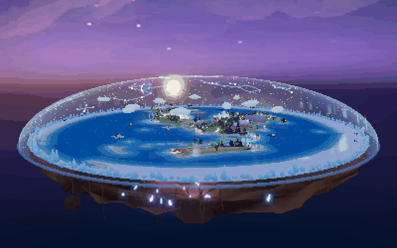
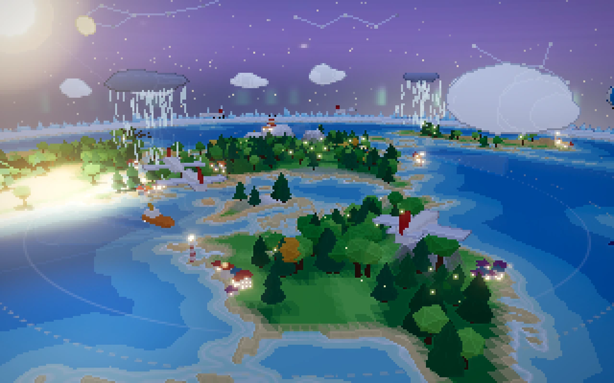
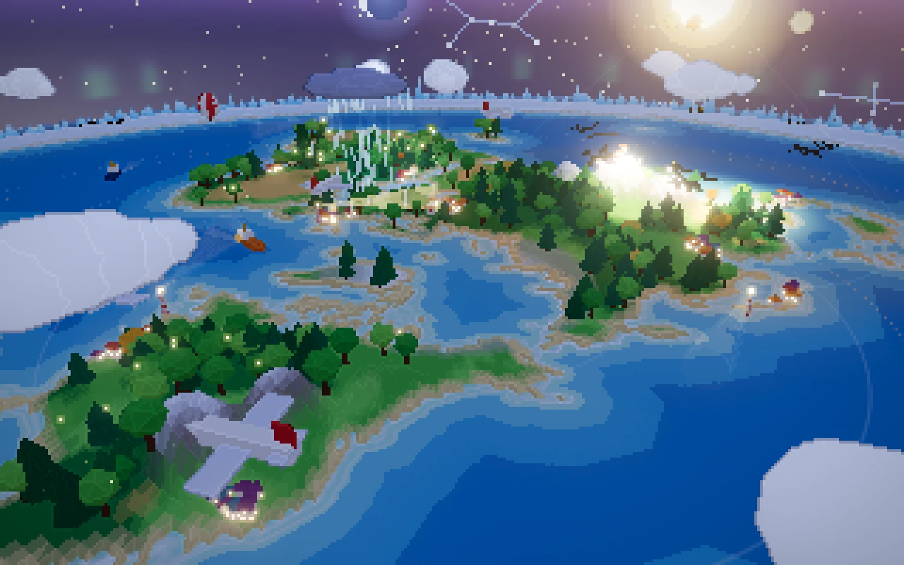
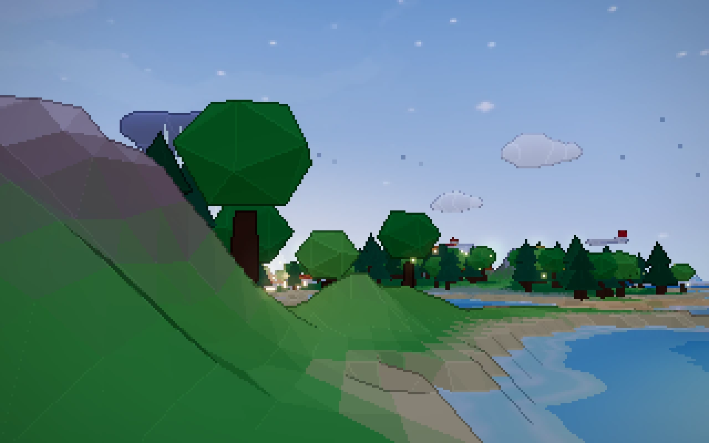
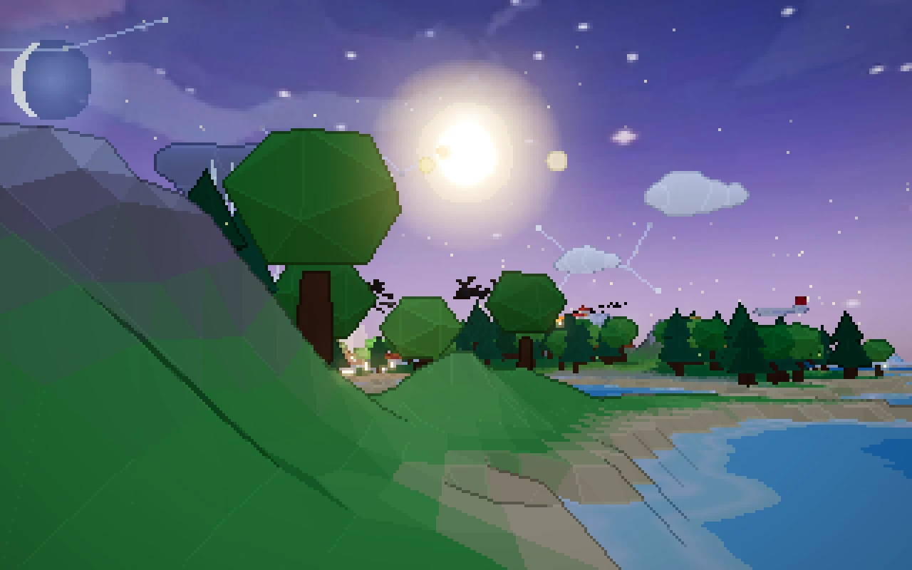
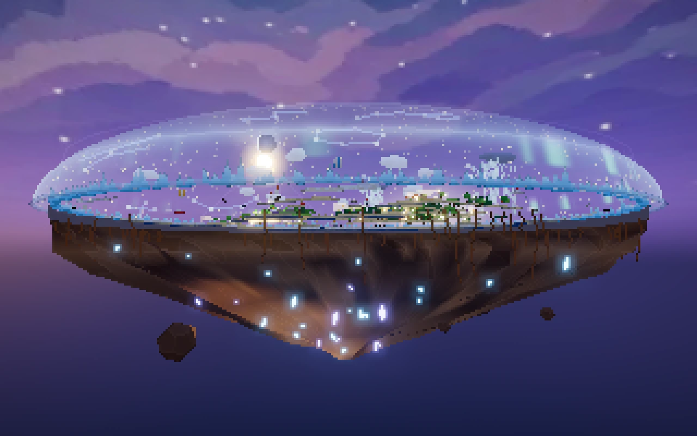
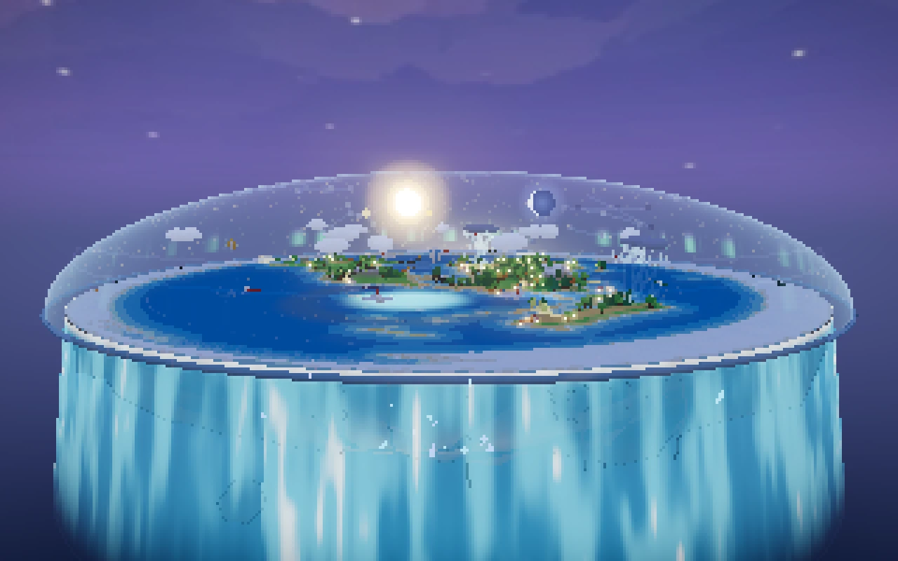
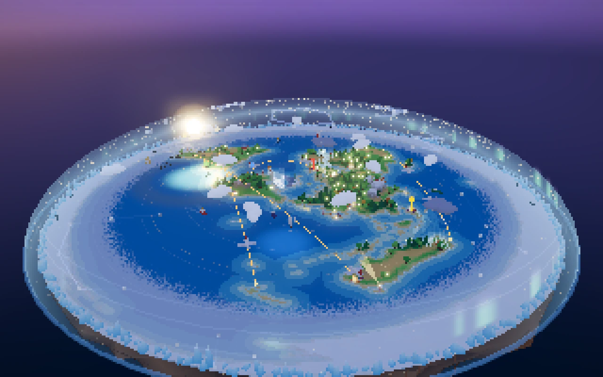
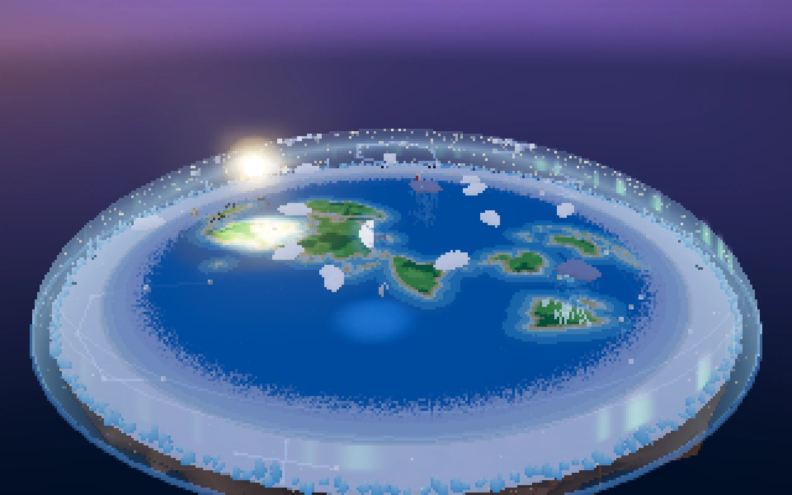

# Flat Earth Sim

*A cozy pixel-art diorama of the flat earth, exactly as its believers describe it. Not a debunk: a faithful render of the lore.*

**▶ Live: [shanahan-suresh.github.io/flat-earth-sim](https://shanahan-suresh.github.io/flat-earth-sim/)**



The sun circles above the disc like a spotlight, the moon shines with its own cold light, the stars turn on a wheel under a glass dome, and the oceans stop at a wall of ice. Every one of those rules comes from the community's own sources; see [The model](#the-model-being-simulated) and [Sources](#sources). Around them sits a small living world: forests, towns that light up at night, lighthouses, boats, planes, birds, fireflies and balloons.

| | |
|---|---|
|  |  |
|  |  |
|  |  |
|  |  |

---

## What you can do

- **Watch a day go by.** The sun sweeps its spotlight across the map; night falls wherever it is not. Town windows and lighthouses come on, fireflies rise over the forests.
- **Scrub the seasons.** The sun's path shrinks to the Tropic of Cancer in June and widens to Capricorn in December. Frost creeps in from the rim in winter.
- **Stand on the disc.** Ground view puts you on a hillside: the sun never sets, it shrinks into the distance, exactly as the model says.
- **Jump to events.** The almanac finds the next full moon, solstice and Shadow-Object eclipse (the moon turns blood red).
- **Pick an edge.** Ice wall, edge waterfall, infinite plane, or the lands beyond the wall.
- **Compare maps.** The standard one-pole map or the rival two-pole map.
- **Take a photo.** Photo mode hides the interface; **S** saves a PNG.
- **Turn the sound on.** Wind, rain, crickets, birds, a foghorn by the ice wall, and gentle generative music, all synthesized live.

---

## Controls

The interface is a row of pixel icons at the bottom; hover any icon for its name.

| Input | Action |
|---|---|
| Left-drag | Orbit (look around, in ground view) |
| Right-drag / two-finger | Pan |
| Scroll | Zoom |
| **Space** | Pause / play |
| **H** | Hide the interface |
| **P** | Photo mode (**S** saves, **Esc** exits) |
| **Esc** | Close a popover |

| Icon group | Contents |
|---|---|
| Dock | Pause, speed, season, edge, view, photo, sound |
| Sky | Dome, clouds, rain, sunbeam, aurora, constellations, Shadow Object, map model, pixel size, reset view, copy link |
| Map | Flight routes, observer pins, traffic, city lights |
| Almanac | Next full moon, eclipse, solstice; postcards (preset views) |
| About | Link here, reset all settings |

Settings are saved in your browser and restored on the next visit.

---

## Run it

```
python serve.py 8000
```

Then open **http://localhost:8000**. On Windows, `run.bat` does both. ES modules are blocked from `file://`, so always serve over HTTP. No build step, no npm.

---

## URL parameters

Set the initial state from the query string, for sharing views and for reproducible screenshots. Parameters override the saved state, apply once, and are then stripped from the address bar. The copy-link button builds the URL for the view on screen.

| Param | Values | Meaning |
|---|---|---|
| `edge` | `icewall` \| `waterfall` \| `infinite` \| `beyond` | Edge mode |
| `dome`, `clouds`, `beam`, `shadow` | `0` \| `1` | Dome / clouds / sunbeam / Shadow Object |
| `aurora` | `0` \| `1` | Aurora over the ice wall |
| `routes` | `0` \| `1` | Flight routes |
| `observers` | `0` \| `1` | Observer pins (KL, London, NYC) |
| `traffic` | `0` \| `1` | Planes and boats |
| `lights` | `0` \| `1` | City lights on the night side |
| `constellations` | `0` \| `1` | Named dome constellations |
| `rain` | `0` \| `1` | Drifting rain cells |
| `audio` | `0` \| `1` | Sound (starts on the first click or key press, a browser rule) |
| `view` | `diorama` \| `ground` | Camera mode |
| `model` | `monopole` \| `bipolar` | Map variant |
| `day` | 0–364 | Day of year |
| `time` | 0–24 | Time of day (decimal hours) |
| `speed` | 0–20 | Time multiplier (`0` = paused) |
| `px` | 2–8 | Pixel size (up close; it shrinks as you zoom out) |
| `cam` | `X,Y,Z` | Camera position |
| `eclipse` | `1` | Jump to the next Shadow-Object eclipse |

Example: `?view=ground&day=172&time=16&speed=0`, a June afternoon on the hillside.

A plain visit (no parameters) opens with the title card, a fade-in and a camera swoop; any parameter skips them.

---

## The model being simulated

| Lore constant | Value |
|---|---|
| Disc radius | 12,450 mi (10 units; 1 unit = 1,245 mi) |
| Map projection | Azimuthal equidistant on the full disc: north pole at the centre, south pole at the edge (Antarctica is the rim). 180° of latitude = 12,450 mi, so the June sun rides the Tropic of Cancer and the December sun the Tropic of Capricorn |
| Ice wall height | ~150 ft in the lore (exaggerated for visibility) |
| Sun diameter | 32 mi in the lore; drawn ~13× larger |
| Moon diameter | 32 mi; self-luminous cold light |
| Sun altitude | ~3,000 mi |
| Sun path radius | 4,600 mi (Jun 21, Tropic of Cancer) to 7,840 mi (Dec 21, Capricorn) |
| Sun ground speed | 1,204 mph (Jun 21) to 2,052 mph (Dec 21) |
| Solar declination | 23.44° amplitude; path radius = 5.0 − 1.3 × sin(decl/max) |
| Moon angular rate | 347.81°/day, giving a 29.53-day synodic month |
| Star wheel period | 23.93 h sidereal day |
| Dome apex | ~3,100–6,000 mi (flattened hemisphere, Y-scale 0.32) |
| Planets | Tychonic: epicycles around the sun |
| Shadow Object | Invisible satellite of the sun; causes lunar eclipses (period ~20 sim-days) |
| Solstices | Day 172 (Jun 21) and day 355 (Dec 21) |
| Winter frost | Strength `(1 + cos(2π(day − 355)/365))/2`, strongest at the December solstice |
| Meteor showers | The Lanternfall (day 224, ×8), The Wheelwright's Sparks (day 349, ×6), The Dome-Menders (day 4, ×5) |
| Constellations | 8 named figures on the sidereal star wheel; The Hub rings Polaris |

### Celestial mechanics

The sun traces a circle above the disc that shrinks and widens with the seasons: smallest in June (over the Tropic of Cancer, r ≈ 3.7 units), largest in December (r ≈ 6.3). One lap every 24 h. It lights only a round patch of the map at a time, and that patch is the day.

The moon follows a similar path at 347.81°/day, gaining 12.19°/day on the sun: one lap relative to the sun every 29.53 days. Its phase is one of eight pixel frames, picked from the sun–moon separation.

Stars are fixed to a wheel that turns once per sidereal day (23.93 h). Polaris sits at the apex and does not move.

The eclipse finder scans forward for the next moment the Shadow Object crosses between sun and moon during a full moon, the same alignment math that tints the moon red.

### Doctrine vs flavour

Everything in the table above is sourced: the sun's path and height, the self-luminous moon, the dome, the Shadow Object, the ice wall, the rival two-pole map. Some things are **invented, not sourced**, and are there to make the diorama feel lived in: the forests, towns, lighthouses, penguins, birds, fireflies and balloons; the floating rock under the disc; the boat loops, the city set and the 14-hour plane legs; the constellation and meteor-shower names; the painted night sky. They decorate the model; they are not claims about it.

### What the consensus actually says

- **Water does not fall off.** The ice wall (~150 ft of Antarctic ice in the lore) holds the oceans in. The edge waterfall is an outsider meme the community disavows; it is here as an option, labelled as such.
- **Gravity is replaced** by density and buoyancy, or by Universal Acceleration (the disc accelerating upward at 9.8 m/s²).
- **The moon is self-luminous**, giving off its own cold light rather than reflecting the sun. This is core TFES doctrine.
- **Lunar eclipses** come from a dark Shadow Object orbiting the sun, not from the earth's shadow.
- **The sun never sets**; it recedes. Ground view shows this: at "sunset" the sun shrinks toward the horizon but stays above it.
- **Southern flights** on the flat map stretch enormously (see the routes overlay). Airlines fly Sydney–Santiago nonstop in ~12.5 h; the community's answer is that real routes are hidden by closed-cockpit navigation.
- **Southern 24-hour daylight** is impossible in the flat model; the community disputes the data.
- **Southern star rotation** around a southern celestial pole is likewise disputed or ignored.
- **The two-pole map** is a rival model; even its advocates disagree on how the sun should move over it, so this sim keeps the standard path.

---

## How it's built

Plain ES modules and [Three.js](https://threejs.org) 0.180.0, vendored. No framework, no bundler, no npm.

- **The look.** The scene renders at a quarter of the screen resolution and is scaled up with hard pixel edges, with light outlines on depth and normal edges. Zoomed out, the pixels shrink in steps so trees and towns keep their shape. Bloom, a colour grade (contrast, saturation, vignette, a lifted indigo shadow) and a pass that snaps the glow back onto the pixel grid finish the frame. Materials use a 4-step toon ramp; the sun is a spotlight that casts real shadows.
- **The land.** Coastlines are [Natural Earth](https://www.naturalearthdata.com) 1:110m outlines, projected onto the disc with the same azimuthal-equidistant formula the lore uses. They are rasterized into a mask, turned into a signed distance field, and raised into a heightfield with beaches, grassland, forest, desert, tundra and snow-capped mountain belts.
- **The water.** A shader colours the sea in crisp depth bands by distance from the coast, with a breathing foam line at the shore, moving wave normals for the sun's glint, and the latitude and tropic circles drawn on it.
- **The sky.** A backdrop shader follows the time of day (navy from above, blue from the ground by day) and blends in a painted night sky at night. Stars are little lamps on the dome that twinkle on their own phases; the dome itself is fresnel glass; the aurora is a shader ring over the ice wall.
- **The life.** Trees, houses, ice shards, birds and planes are instanced or merged low-poly meshes. Everything placed at build time uses a seeded random generator, so every visit shows the same world.
- **The sound.** Everything is synthesized with the Web Audio API: noise-based wind and rain, a drone pad, crickets and birds that follow day and night, and a generative pentatonic music layer. There are no audio files.
- **The state.** One schema drives saving to the browser, the URL parameters and the copy-link button.

The night-sky texture (`assets/tex/nebula.webp`) is **AI-generated** with Google Gemini. Everything else is drawn in code.

### Tests

```
node --test
```

Node's built-in runner (20 or later), no dependencies. The suites pin the synodic month, the solstice wrap, the eclipse finder, the projection scale (the Tropic of Cancer under the June sun path) and the URL state round-trip. GitHub Actions runs them on every push.

---

## Sources

- [wiki.tfes.org](https://wiki.tfes.org): Sun, Equinox, Electromagnetic Acceleration, Universal Acceleration, Lunar Eclipse due to Shadow Object, Southern Celestial Rotation, Tides
- Wikipedia: "Modern flat Earth beliefs"
- NCSE: "The Rim at the End of the World"
- Blake Marnell: *Flat Earth Sun, Moon & Zodiac Clock* app
- Samuel Rowbotham: *Zetetic Astronomy: Earth Not a Globe* (1865): the firmament, the receding sun, the ice barrier
- Orlando Ferguson: *Map of the Square and Stationary Earth* (1893): an early systematic monopole map

---

## Licence and credits

MIT, see [LICENSE](LICENSE). Three.js is MIT (vendored, 0.180.0). The Press Start 2P font is under the SIL Open Font License 1.1 ([assets/PressStart2P-OFL.txt](assets/PressStart2P-OFL.txt)). Coastlines from Natural Earth (public domain). Night-sky texture generated with Google Gemini.
